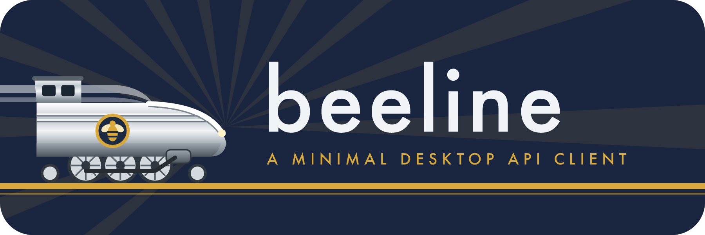
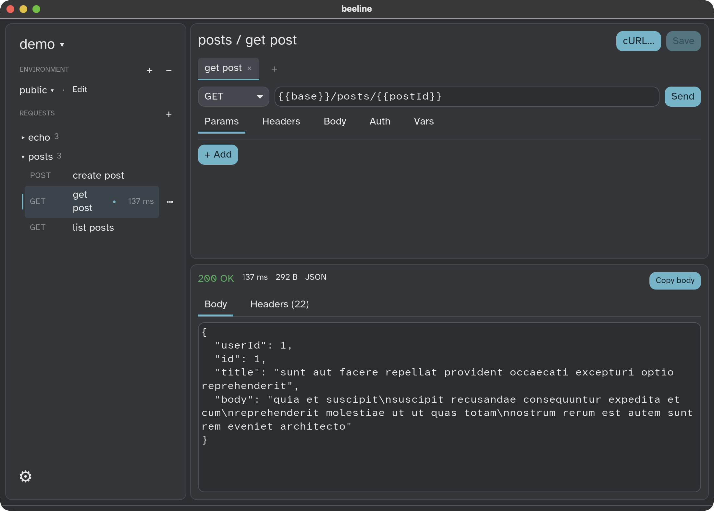

<p align="center">
  
</p>

<p align="center">
  <a href="https://zpeters.github.io/beeline/"><b>Website</b></a>
</p>

<p align="center">
  <a href="https://github.com/zpeters/beeline/actions/workflows/ci.yml"></a>
  <a href="LICENSE"></a>
  
  
</p>

A small, fast desktop API client in the spirit of [Bruno](https://www.usebruno.com/).
A collection is a plain folder of JSON files. You can read them, diff them,
hand-edit them and keep them in git next to your code. There is no account,
no cloud sync and no telemetry.

<p align="center">
  
</p>

## Features

- **Collections on disk.** A folder is a collection. Each request is a
  `*.json` file, and subfolders group them. Create, rename and move to
  Trash from the sidebar.
- **Request editor.** Method, URL, query params (kept in sync with the
  URL), headers, body (JSON, text or form), and bearer or basic auth.
- **Tabs.** Keep several requests open at once.
- **Environments.** Put `environments/<name>.json` in the collection,
  pick one in the sidebar, and use `{{name}}` anywhere in a request.
- **Response viewer.** Status, time, size, pretty-printed JSON (keys stay
  in server order) with syntax colours, and headers. JSON request bodies
  are coloured too.
- **History.** Each request tab keeps its last 20 sends for the session;
  pick one to see that response again.
- **Import** from a cURL command, an OpenAPI 3 or Postman v2.1 file, or a
  Bruno folder.
- **Copy as cURL.** See the exact command for a request and copy it.
- **Response-time sparklines** in the sidebar, for the current session.
- **Light, dark or system theme**, with a choice of fonts and text size.

## Install

### macOS

Download the `.dmg` from the
[latest release](https://github.com/zpeters/beeline/releases/latest), open
it, and drag **beeline** into **Applications**.

The app is not signed or notarised yet, so macOS blocks it the first time.
To open it, try once, then go to **System Settings → Privacy & Security**
and click **Open Anyway**. Or run:

```sh
xattr -dr com.apple.quarantine /Applications/beeline.app
```

### Windows

Download the `-windows-x86_64.zip` from the
[latest release](https://github.com/zpeters/beeline/releases/latest), unzip
it, and run `beeline.exe`. The exe is not signed yet, so SmartScreen may
warn the first time: click **More info → Run anyway**.

### From source

You need Rust (from [rustup](https://rustup.rs/)). The Nix flake and
direnv supply the other tools (`just`, `cargo-bundle`, `resvg`).

```sh
git clone https://github.com/zpeters/beeline
cd beeline
just run                     # open the last collection
cargo run -- examples/demo   # open a folder as the collection
just install-mac             # build beeline.app and copy it into /Applications
just install-win             # build beeline.exe, install it with a Start menu shortcut
```

CI builds and tests beeline on macOS and Linux. On Linux, build it from
source as above (`cargo run --release`) or use the release's `.tar.gz`;
there is no package yet.

## Shortcuts

| Keys | Action |
|---|---|
| ⌘ Enter | Send the request |
| ⌘ S | Save |
| ⌘ T | New tab |
| ⌘ W | Close tab |
| ⌘ N | New request |

On Linux and Windows, use Ctrl instead of ⌘. There is no menu bar there:
the collection menu at the top of the sidebar has New, Open and Import.

## File format

```
my-api/
  environments/dev.json      {"variables": {"base": "https://api.example.com"}}
  users/list users.json      a request; its name is the file name
  health.json
```

A request file. Every field is optional:

```json
{
  "method": "POST",
  "url": "{{base}}/users?notify=true",
  "params": [{ "key": "notify", "value": "true", "enabled": true }],
  "headers": [{ "key": "Accept", "value": "application/json", "enabled": true }],
  "body": { "type": "json", "text": "{\"name\": \"bee\"}" },
  "auth": { "type": "bearer", "token": "{{token}}" }
}
```

- `body.type`: `none`, `json`, `text`, `form` (with `fields`).
- `auth.type`: `none`, `bearer` (`token`), `basic` (`username`, `password`).

See [`examples/demo`](examples/demo) for a working collection.

## Development

```sh
just          # list the recipes
just check    # fmt, clippy (warnings are errors) and tests
just test     # tests only; `cargo test -- --ignored` adds a live HTTPS check
just dmg      # build dist/beeline-<version>.dmg
just icons    # render the icon and banner PNGs from their SVGs
```

- `src/` is the crate. [`AGENTS.md`](AGENTS.md) describes the module
  boundaries and the project rules.
- `docs/superpowers/` holds the design specs and plans: *why* things are
  the way they are.
- Ideas and planned work are in
  [GitHub Issues](https://github.com/zpeters/beeline/issues).

## License

beeline is free software under the
[GNU General Public License v3.0 or later](LICENSE).

The bundled fonts keep their own licences: Inter and IBM Plex Mono under
the SIL Open Font License, and Atkinson Hyperlegible under the Braille
Institute licence. See [`assets/fonts/`](assets/fonts).
